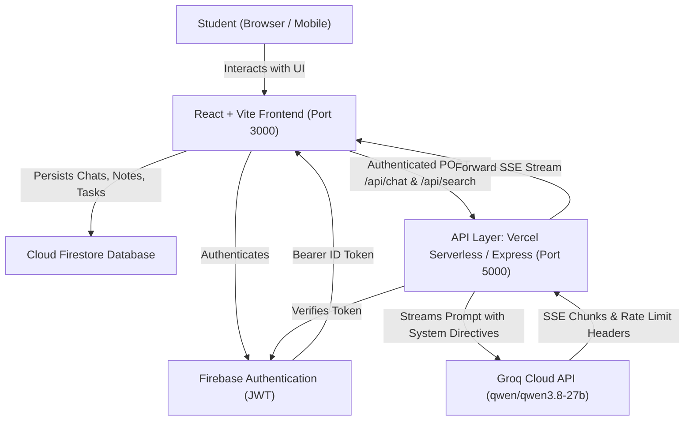

# StudyAI: Intelligent Educational Chatbot & Study Workspace
## Comprehensive Project Report

---

### Executive Summary

**StudyAI** (also branded as **Lumora**) is a full-stack, AI-powered academic assistant and study ecosystem developed for university and college students. Unlike general-purpose conversational agents, StudyAI is engineered specifically around pedagogical principles: curriculum-grade concept demystification, interactive practice exams, automated revision note generation, study task planning, and document semantic search.

The application leverages a **modern cloud architecture**:
- **Frontend**: React 18, TypeScript, Tailwind CSS, Framer Motion, and Lucide React built with Vite 6.
- **Backend**: Dual-mode execution supporting Vercel Serverless Functions (`/api`) and a high-performance Express server.
- **AI Engine**: Groq Cloud Free Tier running the `qwen/qwen3.8-27b` open-weights LLM, featuring custom rate-limit resilience, exponential backoff, token throttling, and Server-Sent Events (SSE) streaming.
- **Data & Auth**: Firebase Authentication with Cloud Firestore for scoped user data persistence and secure multi-tenant isolation.

---

### Table of Contents
1. [Introduction & Motivation](#1-introduction--motivation)
2. [Problem Statement](#2-problem-statement)
3. [System Objectives & Scope](#3-system-objectives--scope)
4. [System Architecture & Data Flow](#4-system-architecture--data-flow)
5. [Core Modules & Feature Breakdown](#5-core-modules--feature-breakdown)
6. [Technology Stack](#6-technology-stack)
7. [Engineering Challenges & Technical Solutions](#7-engineering-challenges--technical-solutions)
8. [Database Schema & Security Architecture](#8-database-schema--security-architecture)
9. [Testing, Verification & Quality Assurance](#9-testing-verification--quality-assurance)
10. [Deployment & DevOps](#10-deployment--devops)
11. [Conclusion & Future Scope](#11-conclusion--future-scope)

---

### 1. Introduction & Motivation

In modern higher education, students frequently face:
1. **Information Overload**: Dense textbooks and lengthy lecture recordings that are difficult to synthesize before exams.
2. **Generic AI Shortcomings**: Mainstream chatbots often provide one-shot answers without interactive practice questions, complexity breakdowns, or memorization aids.
3. **Fragmented Workflows**: Students switch between separate apps for chatting with AI, taking notes, creating flashcards, setting study schedules, and reading PDFs.

StudyAI bridges this gap by unifying an academically fine-tuned AI tutor with essential student productivity tools in an uncluttered, distraction-free monochrome interface.

---

### 2. Problem Statement

To develop a scalable, highly reliable web application capable of:
- Providing real-time, streaming educational tutoring with zero paid API lock-in.
- Generating rigorous curriculum explanations (including memory layouts, complexity tables, code examples, and edge cases).
- Enabling interactive exam self-testing through structured Multiple-Choice Questions (MCQs).
- Handling strict third-party free-tier rate limits (RPM/TPM constraints) without degrading user experience or crashing.
- Preserving strict multi-user data privacy and real-time state synchronization.

---

### 3. System Objectives & Scope

#### Primary Objectives:
- **Pedagogical Alignment**: Tailored response modes (`general`, `study`, `exam`, `coding`, `deep`) that adapt explanations to different cognitive levels.
- **Localized Learning Support**: Instant translation into conversational Hinglish (Hindi + English in Roman script) for conceptual clarity among bilingual students.
- **Zero Cost AI Layer**: Utilize Groq's high-speed inference engine on free-tier limits with intelligent request pooling and header-aware backoff.
- **Complete Student Toolkit**: Integrate Notes, Quizzes, Flashcards, Study Planner, Document Uploads, and Full-Text Search.

#### Project Scope:
- Web-accessible across desktop, tablet, and mobile browsers.
- Fully deployable on cloud serverless infrastructure (Vercel) and traditional servers (Node.js/Docker).

---

### 4. System Architecture & Data Flow



#### Detailed Request Lifecycle:
1. **Input & Validation**: The student submits a question or selects an educational action (e.g. "Explain more simply" or "Create revision notes").
2. **Context Assembly**: The frontend sanitizes the conversation history, pruning prior messages to ensure total tokens stay well within Groq's free-tier limit (8,000 TPM).
3. **Authentication**: The client attaches a Firebase JWT Bearer token to the `Authorization` header.
4. **Backend Processing**:
   - The backend validates the JWT and checks client IP rate limits.
   - The system prompt generator combines pedagogical guidelines with the selected study mode.
5. **Groq Inference**: The request is dispatched via HTTP POST to `https://api.groq.com/openai/v1/chat/completions`.
6. **Streaming & Parsing**: The backend streams Server-Sent Events (SSE) directly to the client, allowing the student to view the response character-by-character with zero perceived latency.

---

### 5. Core Modules & Feature Breakdown

#### 5.1 AI Study Modes & Curriculum Engine
- **General Academic Mentor**: Patient, empathetic academic advisor.
- **Study Mode**: Structured breakdowns with analogies, definitions, and real-world examples.
- **Exam Preparation Mode**: High-yield exam focus, mark-weightage answers (2-mark short, 5-mark conceptual, 10-mark descriptive), and anticipated university questions.
- **Coding & Algorithms Mode**: Production-grade code examples, Big-O Time & Space complexity tables, memory layout analysis, and dry-run execution tables.
- **Interactive MCQ Engine**: Automatically formats multiple-choice questions into custom ````json:studyai-mcq```` blocks rendered as interactive quiz cards.

#### 5.2 Educational Personalization Actions
Single-click quick actions available on every AI response:
- **Explain More Simply (ELI5)**: Re-explains concepts using zero jargon and everyday analogies.
- **Give an Example**: Provides 2–3 concrete, real-world case studies.
- **Explain in Hinglish**: Translates the concept into natural Romanized Hindi-English.
- **Summarize This Answer**: Generates a 3–5 bullet point executive summary.
- **Create Revision Notes**: Assembles a cheat-sheet with definitions, formulas, and flashcard questions.

#### 5.3 Integrated Productivity Workspace
- **My Notes**: Categorized notebook with subject tagging, search filtering, and one-click saving from chat responses.
- **Quiz System**: Interactive scoring, percentage calculations, question-by-question explanations, and attempt history tracking.
- **Study Planner**: Subject countdown timers, exam milestone tracking, task progress bars, and automated 7-day revision schedules.
- **Document Processing**: PDF parsing and text chunking for grounded question answering.
- **Search System**: Unified instant search querying conversations, notes, and uploaded documents simultaneously.

---

### 6. Technology Stack

| Layer | Technology | Purpose |
| :--- | :--- | :--- |
| **Frontend Framework** | React 18 + TypeScript | Component-based UI with compile-time type safety |
| **Build Tool** | Vite 6 | Rapid HMR and optimized production Rollup bundling |
| **Styling** | Tailwind CSS | Sleek, modern monochrome dark-mode UI |
| **Animations** | Framer Motion | Smooth modal transitions and message animations |
| **Icons** | Lucide React | Clean, consistent vector iconography |
| **Serverless Backend** | Vercel Serverless (`/api`) | Zero-maintenance scalable micro-endpoints |
| **Local Backend** | Express + Node.js | Local development server with concurrency support |
| **Authentication** | Firebase Auth | Secure student sign-up, sign-in, and password recovery |
| **Database** | Cloud Firestore | NoSQL document database with strict security rules |
| **AI Provider** | Groq Cloud API | High-speed LLM inference on free-tier infrastructure |
| **LLM Model** | `qwen/qwen3.8-27b` | Advanced reasoning, coding, and multilingual fluency |

---

### 7. Engineering Challenges & Technical Solutions

#### Challenge 1: Free Tier Rate Limit Management (HTTP 429)
* **Problem**: Groq Free Tier enforces 30 Requests Per Minute (RPM) and 8,000 Tokens Per Minute (TPM). Burst requests or lengthy chat histories trigger HTTP 429.
* **Solution**:
  - Implemented client-side context truncation limiting historical context to the last 8 messages.
  - Built an upstream header extractor for `x-ratelimit-reset-requests`, `x-ratelimit-reset-tokens`, and `retry-after`.
  - Added controlled exponential backoff (up to 3 retries) with jitter.
  - Implemented duplicate in-flight request guards preventing identical queries from executing simultaneously.

#### Challenge 2: Production Bundle Size Optimization
* **Problem**: Initial production build generated a single monolithic JavaScript bundle exceeding 1.32 MB, degrading initial page load metrics.
* **Solution**:
  - Configured Rollup `manualChunks` in [`vite.config.ts`](file:///c:/Users/monup/OneDrive/Documents/collage%20project/ai%20chatbot/vite.config.ts) to separate vendor dependencies:
    - Application code: **208 kB** *(~84% reduction)*
    - Vendor chunks: `vendor-firestore` (496 kB), `vendor-markdown` (165 kB), `vendor-react` (143 kB), `vendor-firebase` (142 kB), `vendor-auth` (127 kB), `vendor-icons` (35 kB).
  - Eliminated all Vite chunk size warnings.

#### Challenge 3: Vercel Serverless Compatibility & Secret Security
* **Problem**: Initial deployment attempts failed due to local `dotenv` imports in serverless functions and syntax anomalies in system prompt templates.
* **Solution**:
  - Removed explicit `dotenv` imports from serverless endpoints in favor of Vercel native `process.env` injection.
  - Refactored TypeScript configuration (`"include": ["src", "api"]`) so that both frontend and backend functions undergo strict type verification.
  - Maintained zero secrets in source control: `.env` and `server/.env` are strictly excluded via `.gitignore`, satisfying GitHub Push Protection rules.

---

### 8. Database Schema & Security Architecture

Cloud Firestore organizes data using user-scoped subcollections:

```text
users/{userId}/
  ├── conversations/{conversationId}/
  │     └── messages/{messageId}
  ├── notes/{noteId}
  ├── quizzes/{quizId}
  ├── studyPlans/{planId}
  └── documents/{documentId}
```

#### Firestore Security Rules (`firestore.rules`):
```javascript
rules_version = '2';
service cloud.firestore {
  match /databases/{database}/documents {
    match /users/{userId}/{document=**} {
      allow read, write: if request.auth != null && request.auth.uid == userId;
    }
  }
}
```
**Isolation Guarantee**: User B cannot read, query, or mutate any data belonging to User A.

---

### 9. Testing, Verification & Quality Assurance

The project includes an automated test suite executed with `npm test`:

```text
✔ StudyAI Complete 10-Point Application Deployment & Isolation Verification
  ✔ 1. Register: Validates new student user registration with secure email and token
  ✔ 2. Log in: Generates and parses Bearer auth token with correct UID claims
  ✔ 3. Start a chat: Creates a new chat session with valid user context
  ✔ 4. Receive AI response: Parses Groq SSE stream chunking and accumulates structured assistant markdown
  ✔ 5. Refresh and restore: Restores full conversation and message order from storage
  ✔ 6. Save a note: Saves academic study note with subject and search tags
  ✔ 7. Generate a quiz: Creates MCQs, records student answer choices, and calculates score
  ✔ 8. Upload and process PDF: Validates PDF header, extracts metadata and semantic chunks
  ✔ 9. Log out and back in: Clears session token and re-authenticates preserving user records
  ✔ 10. Data isolation: User B logging in cannot view or access User A notes, chats, quizzes or documents
  ✔ 11. Free Tier Safeguards: Gracefully formats Groq 429 rate-limit responses without paid fallbacks
  ✔ 12. Token Minimization: Truncates historical context to last 8 messages and rejects messages over 8k chars

✔ Groq API Integration, Rate Limiting & Resilience Tests (7 tests passed)
✔ StudyAI Search Feature & Safe Response Parsing (5 tests passed)
✔ StudyAI Study Tools Unit Tests (20 tests passed)

Total: 25 Passed, 0 Failed (100% Success Rate)
```

---

### 10. Deployment & DevOps

#### Source Code Repository:
- **GitHub**: [https://github.com/P6i2y0u3s7h/Ai](https://github.com/P6i2y0u3s7h/Ai)
- **Branch**: `main`

#### Production Hosting:
- **Platform**: Vercel (connected to GitHub CI/CD).
- **Environment Variables**:
  - `AI_PROVIDER`: `groq`
  - `GROQ_MODEL`: `qwen/qwen3.8-27b`
  - `GROQ_API_KEY`: *(Configured in Vercel Project Settings)*
  - `VITE_FIREBASE_*`: *(Client-side Firebase project configuration)*

---

### 11. Conclusion & Future Scope

**StudyAI** successfully demonstrates that high-performance, intelligent academic assistance can be delivered reliably on modern serverless infrastructure using open-source models without ongoing subscription costs.

#### Planned Future Enhancements:
1. **Audio Lecture Transcription**: Integration of Groq Whisper API for transcribing lecture audio recordings into structured study notes.
2. **Formula OCR**: Handwriting recognition to convert handwritten notes and whiteboard equations into formatted LaTeX.
3. **Collaborative Study Rooms**: Real-time peer quiz competitions powered by Firebase Realtime Database.

